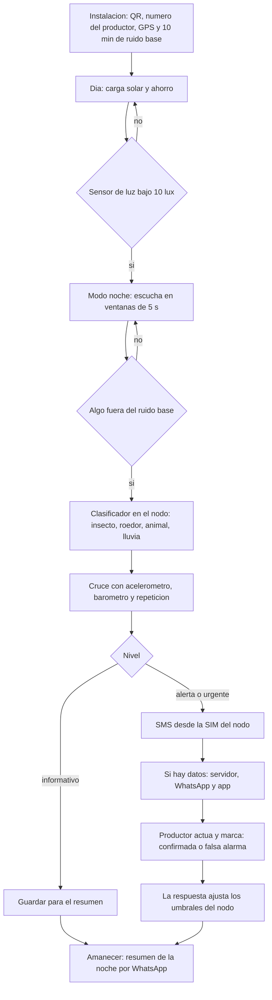

# pocketNode: propuesta de software

Detección temprana de plagas nocturnas con celulares reciclados. Este documento
describe cómo funciona el software: qué hace cada sensor, cómo se decide una
alerta y cómo llega al productor.

Alcance del Rally: propuesta y MVP virtual. No se construye hardware.

## Pregunta que responde

- ¿Cómo proteger las cosechas de las plagas nocturnas a tiempo y con tecnología
  accesible?
- ¿Por qué el productor se entera solo cuando la plaga ya devoró el cultivo?

## Piezas del sistema

| pieza | dónde corre | qué hace |
|---|---|---|
| App Nodo | celular reciclado en la parcela (Android 5.0, API 21) | escucha, mide, decide y avisa; funciona sin internet |
| App Productor | celular del productor | mapa de nodos, alertas, audio del evento, estado del nodo |
| Avisos | SMS desde la SIM del nodo; WhatsApp desde el servidor | alerta para quien no usa apps |
| Servidor y tablero | nube | guarda eventos, envía WhatsApp, tablero para cooperativa o técnico agrícola |

La regla de diseño: **el SMS sale del propio nodo.** Si no hay datos móviles ni
servidor, la alerta llega igual. WhatsApp, la app y el tablero son capas
encima, no requisitos.

## Integración de sensores

Cada sensor tiene un papel. Ninguno decide solo: el motor de reglas cruza las
señales para bajar las falsas alarmas.

| sensor | papel en pocketNode | señal que produce |
|---|---|---|
| Sensor de luz | interruptor del modo noche; antirrobo de la caja | `noche` (bajo 10 lux); `caja_abierta` si hay luz de golpe de noche |
| Micrófono | detector principal | perros, ganado y aves; en la trampa de feromona, con micrófono externo en el embudo, armónicos del aleteo de polillas (ver [deteccion-tecnica.md](deteccion-tecnica.md)) |
| Acelerómetro | vibración del poste o estaca | `contacto` cuando un animal roza o trepa; `viento` para descartar ruido |
| Giroscopio | inclinación del nodo | `nodo_caido` si el poste se inclina o cae |
| Magnetómetro | orientación fija desde la instalación | `nodo_movido` si alguien gira o se lleva el equipo |
| GPS | ubicación fijada al instalar | coordenadas de cada evento; confirma que el nodo sigue en su sitio |
| Barómetro (si existe) | contexto del clima | `tormenta`: sube el umbral de audio (lluvia y viento) y suma riesgo de hongos |
| Temperatura de batería | autodiagnóstico | `sobrecalentamiento`: baja el trabajo del nodo |
| Wi-Fi y Bluetooth | conexión y vecinos | sube datos cuando hay red; detecta otros nodos cercanos |

Sobre hongos: el celular no mide humedad. El riesgo de hongos es una
**estimación** (noches con lluvia detectada por audio y barómetro, más
temperatura) y así se presenta, no como detección.

## Dos modos: cultivo y ganado

El mismo nodo trabaja en uno de dos modos, elegido al instalarlo.

| | modo cultivo | modo ganado |
|---|---|---|
| Dónde va | poste en la parcela (café, maíz, frijol) | poste del corral, portón o cerco |
| Qué busca | plagas nocturnas | ganado extraviado, depredadores (perros, zorro), animal en apuros, cerco caído |
| Acelerómetro | roce en el poste | apertura del portón, golpe o inclinación del cerco |
| Aviso típico | "Gusano cogollero: riesgo de infestación en el maíz" | "Perros cerca del corral a las 2:40" |

## Plagas que busca el modo cultivo

**Actualizado:** las polillas se detectan con trampa de feromona, micrófono externo dentro del embudo y conteo por cámara, no oyéndolas volar a distancia. El detalle técnico, con fuentes, está en [deteccion-tecnica.md](deteccion-tecnica.md).

| plaga | cultivo | firma acústica | estado |
|---|---|---|---|
| Polilla del gusano cogollero (*Spodoptera frugiperda*) | maíz | aleteo continuo del adulto antes de poner huevos en el cogollo | a entrenar |
| Gusano elotero (*Helicoverpa zea*) | granos básicos | vuelo y actividad nocturna del adulto | a entrenar |
| Escarabajos y plagas voladoras nocturnas | varios | masticado masivo o zumbido grueso cuando la población sube | a entrenar |
| Broca del café (*Hypothenemus hampei*) | café | zumbido de baja amplitud del adulto al volar entre frutos | **hipótesis a validar**: mide unos 2 mm y no está comprobado que un micrófono de celular la capte a distancia |

## Lógica de riesgo (modo cultivo)

| fase | qué evalúa | resultado |
|---|---|---|
| 1. Presencia | eventos acústicos aislados | queda en el resumen de la mañana |
| 2. Densidad | eventos por hora contra el umbral económico (ejemplo: más de 50 por hora) | sube a alerta |
| 3. Microclima | noches cálidas y húmedas después de lluvia (barómetro, lluvia oída, temperatura) | baja el umbral: es cuando brotan plagas y hongos como la roya |
| 4. Riesgo de infestación | densidad e intensidad sobre el umbral de daño | SMS al productor |

El umbral de 50 eventos por hora es un ejemplo. El valor real se calibra por
cultivo en la prueba de campo.

## Filtrado de ruido

El modelo se entrena con un conjunto de sonidos de fondo que aprende a
descartar:

- Naturaleza: lluvia, viento en el follaje, truenos.
- Fauna no dañina: grillos, ranas, chicharras, aves nocturnas.
- Ruido humano: vehículos, motores, herramientas, voces. Siempre se descarta:
  pocketNode no vigila personas ni vehículos.

## Red de nodos

Un terreno amplio lleva **6 nodos por hectárea**, unos 41 m entre nodos. El
cálculo y lo que implica para la cobertura están en [deteccion-tecnica.md](deteccion-tecnica.md), pregunta 8.

- **Confirmación cruzada:** si dos nodos vecinos oyen lo mismo, la confianza
  sube y el aviso dice por dónde avanza la plaga.
- **Relevo:** un nodo sin señal pasa su aviso por Wi-Fi o Bluetooth al vecino
  que sí tiene señal, y ese envía el SMS.
- **Mapa de calor:** el tablero muestra qué zona de la finca concentra más
  eventos por semana.
- **Salud de la red:** si un nodo deja de reportar, el vecino lo nota y avisa.

## Motor de reglas en el nodo

Cada evento sale con un nivel y una confianza.

| nivel | cuándo | canal |
|---|---|---|
| Informativo | una señal aislada | solo queda en el resumen de la mañana |
| Alerta | audio de plaga sostenido por más de 2 minutos | app y WhatsApp |
| Urgente | audio de plaga más vibración del poste, o un evento repetido en la misma noche | SMS inmediato, app y WhatsApp |
| Equipo | caja abierta, nodo movido o caído, batería baja | SMS al responsable del nodo |

## Flujo de trabajo



## App Productor: experiencia de uso

Público: personas mayores y productores con poca experiencia en tecnología. La
app se diseña para que se entienda sin leer instrucciones.

### Principios

| principio | en la práctica |
|---|---|
| Una pregunta por pantalla | el inicio responde solo "¿está bien mi cultivo?" |
| Semáforo con palabra y dibujo | verde "Todo tranquilo", amarillo "Ojo", rojo "Vaya a ver"; nunca solo color |
| Palabras del campo | "ratas", "gusanos", "animal grande"; nada de "roedor" ni porcentajes: "Seguro" o "Puede ser" |
| Letra y botones grandes | texto de 20 px como mínimo; botones a lo ancho de 64 px de alto |
| Todo se puede escuchar | botón "Escuchar" que lee el aviso en voz alta (voz del propio Android, sin internet) |
| Dos botones como máximo | cada aviso se responde con "Ya fui a ver" o "No era nada" |
| Sin contraseñas | la cooperativa o el técnico instala con un código QR; se entra con el número de teléfono |
| Ayuda a un toque | botón fijo "Llamar al técnico" |
| Avisos distintos | el urgente suena y vibra diferente, incluso con el celular bloqueado |
| Lo mismo fuera de la app | WhatsApp y SMS repiten el aviso y aceptan la respuesta 1 o 2, o una nota de voz |

### Pantallas

1. **Inicio:** semáforo grande de la parcela y una frase.
2. **Aviso:** dibujo grande de la plaga, dónde está, qué hacer, botón
   "Escuchar" y las dos respuestas.
3. **Mis aparatos:** cada nodo con una sola palabra de estado (Bien, Poca
   batería, Movido).
4. **WhatsApp y SMS:** el mismo aviso para quien no abre la app.

5. **Mis números:** métricas sencillas, una por tarjeta, con palabra y
   dibujo: noches tranquilas del mes, avisos atendidos, la plaga más vista,
   la zona con más avisos y cuánto trabajaron los aparatos. Barras grandes,
   sin ejes ni decimales.

## Ejemplo de mensaje

```text
pocketNode: VAYA A VER
Ratas en la orilla norte de Los Naranjos (aparato 2).
Desde las 2:14 de la madrugada. Seguro.
Responda 1 si ya fue a ver, 2 si no era nada.
```

## Paleta

| color | uso |
|---|---|
| `#FFFFFF` blanco | fondo de tarjetas y texto sobre verde bosque |
| `#D1E3B3` verde claro | fondo de la app, estado tranquilo |
| `#074736` verde bosque | marca, encabezados, botón principal |
| `#CBDB7C` verde lima | acento, botón Escuchar, resaltados |
| `#84441A` café rojizo | ganado, tierra, estado de atención |
| `#42271A` café oscuro | texto principal |

El rojo de aviso urgente (`#C0392B`) queda fuera de la paleta a propósito: es
un color de alarma y no se reutiliza para nada más.

## Tecnología propuesta

Se propone, todavía no se instala nada. Cada dependencia se confirmará y se
registrará en `docs/STACK_TECNOLOGICO.md` antes de entrar.

| capa | propuesta |
|---|---|
| App Nodo | Android nativo en Kotlin con minSdk 21; clasificador de audio TensorFlow Lite en el dispositivo |
| App Productor | Android; modo simple con botones grandes |
| Servidor | API, base de datos y cola de avisos, contenerizado con Docker |
| WhatsApp | WhatsApp Business Cloud API (necesita cuenta de Meta y plantillas aprobadas) |
| SMS | API de SMS de Android desde la SIM del nodo |

## MVP virtual

Una simulación animada en el navegador de una noche completa: el anochecer
activa el nodo, aparece una plaga, los sensores reaccionan, el nodo decide y la
alerta llega al celular del productor por app, SMS y WhatsApp. Se grabará con
Playwright una vez aprobada la propuesta visual.
