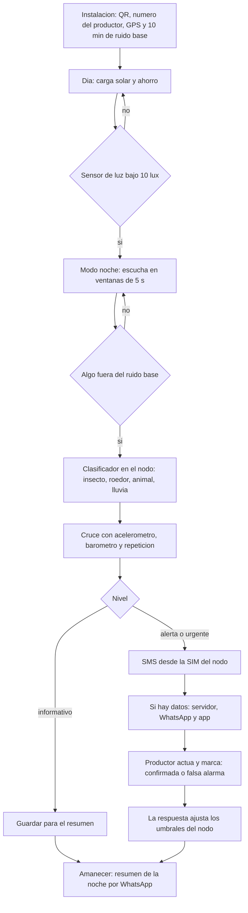

# pocketNode: propuesta de software

Detección temprana de plagas nocturnas con celulares reciclados. Este documento
describe cómo funciona el software: qué hace cada sensor, cómo se decide una
alerta y cómo llega al productor.

Alcance del Rally: propuesta y MVP virtual. No se construye hardware.

## Pregunta que responde

- ¿Cómo proteger las cosechas de las plagas nocturnas a tiempo y con tecnología
  accesible?
- ¿Por qué el productor se entera solo cuando la plaga ya devoró el cultivo?

## Piezas del sistema

| pieza | dónde corre | qué hace |
|---|---|---|
| App Nodo | celular reciclado en la parcela (Android 5.0, API 21) | escucha, mide, decide y avisa; funciona sin internet |
| App Productor | celular del productor | mapa de nodos, alertas, audio del evento, estado del nodo |
| Avisos | SMS desde la SIM del nodo; WhatsApp desde el servidor | alerta para quien no usa apps |
| Servidor y tablero | nube | guarda eventos, envía WhatsApp, tablero para cooperativa o técnico agrícola |

La regla de diseño: **el SMS sale del propio nodo.** Si no hay datos móviles ni
servidor, la alerta llega igual. WhatsApp, la app y el tablero son capas
encima, no requisitos.

## Integración de sensores

Cada sensor tiene un papel. Ninguno decide solo: el motor de reglas cruza las
señales para bajar las falsas alarmas.

| sensor | papel en pocketNode | señal que produce |
|---|---|---|
| Sensor de luz | interruptor del modo noche; antirrobo de la caja | `noche` (bajo 10 lux); `caja_abierta` si hay luz de golpe de noche |
| Micrófono | detector principal | aleteo de insectos (banda de 100 a 600 Hz), roedores y animales (chillidos, pisadas, roer) |
| Acelerómetro | vibración del poste o estaca | `contacto` cuando un animal roza o trepa; `viento` para descartar ruido |
| Giroscopio | inclinación del nodo | `nodo_caido` si el poste se inclina o cae |
| Magnetómetro | orientación fija desde la instalación | `nodo_movido` si alguien gira o se lleva el equipo |
| GPS | ubicación fijada al instalar | coordenadas de cada evento; confirma que el nodo sigue en su sitio |
| Barómetro (si existe) | contexto del clima | `tormenta`: sube el umbral de audio (lluvia y viento) y suma riesgo de hongos |
| Temperatura de batería | autodiagnóstico | `sobrecalentamiento`: baja el trabajo del nodo |
| Wi-Fi y Bluetooth | conexión y vecinos | sube datos cuando hay red; detecta otros nodos cercanos |

Sobre hongos: el celular no mide humedad. El riesgo de hongos es una
**estimación** (noches con lluvia detectada por audio y barómetro, más
temperatura) y así se presenta, no como detección.

## Motor de reglas en el nodo

Cada evento sale con un nivel y una confianza.

| nivel | cuándo | canal |
|---|---|---|
| Informativo | una señal aislada | solo queda en el resumen de la mañana |
| Alerta | audio de plaga sostenido por más de 2 minutos | app y WhatsApp |
| Urgente | audio de plaga más vibración del poste, o un evento repetido en la misma noche | SMS inmediato, app y WhatsApp |
| Equipo | caja abierta, nodo movido o caído, batería baja | SMS al responsable del nodo |

## Flujo de trabajo



## App Productor: pantallas

1. **Mi parcela:** mapa con los nodos y su estado de la noche (tranquila,
   alerta, urgente).
2. **Alerta:** qué se detectó, dónde, a qué hora, con qué confianza; audio de 5
   segundos para escuchar y la acción recomendada.
3. **Nodo:** batería, carga solar, señal, temperatura y último contacto.
4. **Resumen de la noche:** línea de tiempo con los eventos.

Para personas mayores o poco acostumbradas a apps: la misma información llega
por WhatsApp y por SMS con un texto corto y una sola acción.

## Ejemplo de mensaje

```text
pocketNode URGENTE
Parcela Los Naranjos, nodo 2 (orilla norte)
Posible roedor desde las 2:14 a. m. (confianza 87 %)
Revise la orilla norte. Responda 1 si lo vio, 2 si fue falsa alarma.
```

## Tecnología propuesta

Se propone, todavía no se instala nada. Cada dependencia se confirmará y se
registrará en `docs/STACK_TECNOLOGICO.md` antes de entrar.

| capa | propuesta |
|---|---|
| App Nodo | Android nativo en Kotlin con minSdk 21; clasificador de audio TensorFlow Lite en el dispositivo |
| App Productor | Android; modo simple con botones grandes |
| Servidor | API, base de datos y cola de avisos, contenerizado con Docker |
| WhatsApp | WhatsApp Business Cloud API (necesita cuenta de Meta y plantillas aprobadas) |
| SMS | API de SMS de Android desde la SIM del nodo |

## MVP virtual

Una simulación animada en el navegador de una noche completa: el anochecer
activa el nodo, aparece una plaga, los sensores reaccionan, el nodo decide y la
alerta llega al celular del productor por app, SMS y WhatsApp. Se grabará con
Playwright una vez aprobada la propuesta visual.
